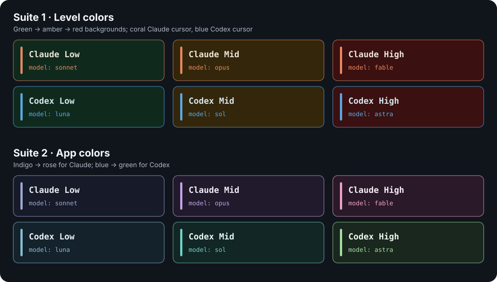

# Terminal Model Profile Switcher

Automatically switch macOS Terminal.app profiles when Claude Code or OpenAI Codex changes models. One Bash script runs from the apps' hooks; no background process is needed.

| App | Active model contains | Terminal profile |
| --- | --- | --- |
| Claude Code | `sonnet` | **Claude Low** |
| Claude Code | `opus` | **Claude Mid** |
| Claude Code | `fable` | **Claude High** |
| Codex | `luna` | **Codex Low** |
| Codex | `sol` | **Codex Mid** |
| Codex | `astra` | **Codex High** |
| Either | Session ends | **Basic** |

Matching is case insensitive and works with longer model IDs containing these names.

## Requirements

- macOS with Terminal.app and the profiles listed above
- Bash, AppleScript (`osascript`), and `jq`
- Claude Code or Codex with command hooks enabled

## Install

From this repository:

```bash
cp term-profile.sh "$HOME/term-profile.sh"
chmod +x "$HOME/term-profile.sh"
```

Make sure `jq` is installed and available on the `PATH` seen by hooks. The first Terminal automation attempt may prompt macOS for permission; allow the app running the hook to control Terminal.

## Create or import Terminal profiles

Import one optional suite or create your own profiles with the names above.



| Suite | Look | Files |
| --- | --- | --- |
| **1 · Level colors** | Green for Low, amber for Mid, red for High; coral Claude cursor and blue Codex cursor | [`profiles/suite_1/`](profiles/suite_1/) |
| **2 · App colors** | Indigo to rose for Claude; blue to green for Codex | [`profiles/suite_2/`](profiles/suite_2/) |

1. Open **Terminal → Settings → Profiles → action menu → Import**.
2. Import all six `.terminal` files from **one** suite. Both suites use identical names; remove the old six before switching suites.
3. Keep Terminal's built-in `Basic` profile for resets, or recreate it if removed. It is not bundled.

Custom profile names must match the table exactly, including capitalization and spaces.

## Customize the mapping

Edit `profile_for_model` in `~/term-profile.sh` to change model matches or profile names. Change `Basic` in the reset branch to use a different reset profile.

## Codex hooks

Add these entries to `~/.codex/config.toml`, merging them with any hooks you already have:

```toml
[[hooks.SessionStart]]
[[hooks.SessionStart.hooks]]
type = "command"
command = '"$HOME/term-profile.sh"'
timeout = 3

[[hooks.UserPromptSubmit]]
[[hooks.UserPromptSubmit.hooks]]
type = "command"
command = '"$HOME/term-profile.sh"'
timeout = 3

[[hooks.SessionEnd]]
[[hooks.SessionEnd.hooks]]
type = "command"
command = '"$HOME/term-profile.sh" reset'
timeout = 3
```

Codex may ask you to review or trust these hooks before it runs them. Restart Codex in Terminal.app to try the configuration.

## Claude Code hooks

Merge this `hooks` object into `~/.claude/settings.json` (keep any other settings already there):

```json
{
  "hooks": {
    "SessionStart": [{ "hooks": [{ "type": "command", "command": "\"$HOME/term-profile.sh\"", "timeout": 3 }] }],
    "UserPromptSubmit": [{ "hooks": [{ "type": "command", "command": "\"$HOME/term-profile.sh\"", "timeout": 3 }] }],
    "PostModelSwitch": [{ "hooks": [{ "type": "command", "command": "\"$HOME/term-profile.sh\"", "timeout": 3 }] }],
    "SessionEnd": [{ "hooks": [{ "type": "command", "command": "\"$HOME/term-profile.sh\" reset claude", "timeout": 3 }] }]
  }
}
```

Model-switch updates require Claude Code 2.1.251 or later. See the [hook reference](https://code.claude.com/docs/en/hooks).

## Known limitations

- **Codex `/mode`:** the profile updates on the **next submitted prompt**.
- **Codex targets the selected tab in Terminal's front window.** Background hooks can change the wrong tab, including on reset. Claude locates its own tab through the hook process's tty ancestry.
- Claude's `SessionStart` can omit the model; the profile then waits for `PostModelSwitch`. `UserPromptSubmit` does not supply the model.
- Only Terminal.app is supported. Unknown models leave the profile unchanged.

## Troubleshooting

For diagnostics, run this manual check with the intended Terminal tab selected. It applies the Codex Mid profile:

```bash
printf '%s\n' '{"model":"gpt-6-sol"}' | TERM_PROFILE_DEBUG=1 "$HOME/term-profile.sh"
```

The script is silent by default and creates no logs. Debug mode prints the validated model ID and Terminal errors to stderr; it does not print prompts or raw payloads.

If nothing changes, check:

- The script is executable and `jq` is on the hook's `PATH`.
- Profile names match and macOS has allowed Terminal automation.
- Claude debug output has no `no tty found` or `no Terminal tab matched` error.

All configured hooks time out after three seconds; retry after granting automation permission. Direct script invocations have no built-in deadline.

## Tests

Run `python3 -m unittest discover -s tests -v` with Python 3.11+ and `jq`.

Verified 2026-09-26: regression tests and Bash syntax passed on macOS 26.5.1 (25F80), Bash 3.2.57(1)-release (arm64), jq 1.6, and Python 3.12.13. Installed apps: Claude Code 2.1.283 and Codex CLI 0.157.1.

Tests stub Terminal automation. Live hooks, profile changes, and permission prompts remain unverified.

## Uninstall

Remove the hook entries above from `~/.codex/config.toml` and `~/.claude/settings.json`, then remove the installed script:

```bash
rm "$HOME/term-profile.sh"
```

## License

MIT. See [LICENSE](LICENSE).
